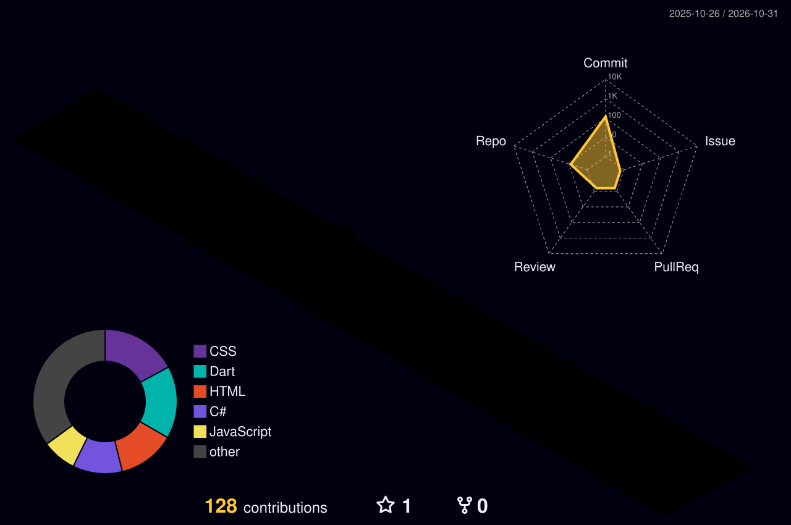

<picture>
  <source media="(prefers-color-scheme: dark)" srcset="https://capsule-render.vercel.app/api?type=waving&color=0:0a0f1e,50:1a2744,100:0d1b2a&height=160&section=header" />
  <source media="(prefers-color-scheme: light)" srcset="https://capsule-render.vercel.app/api?type=waving&color=0:e0e7ff,50:c7d2fe,100:a5b4fc&height=160&section=header" />
  
</picture>

<picture>
  <source media="(prefers-color-scheme: dark)" srcset="https://readme-typing-svg.herokuapp.com?font=JetBrains+Mono&size=15&duration=3500&pause=1200&color=7EB8D4&center=true&vCenter=true&width=500&lines=Web+Dev+%C2%B7+Mobile+Dev+%C2%B7+IT+Infrastructure;Always+building%2C+always+learning" />
  <source media="(prefers-color-scheme: light)" srcset="https://readme-typing-svg.herokuapp.com?font=JetBrains+Mono&size=15&duration=3500&pause=1200&color=1e3a5f&center=true&vCenter=true&width=500&lines=Web+Dev+%C2%B7+Mobile+Dev+%C2%B7+IT+Infrastructure;Always+building%2C+always+learning" />
  
</picture>

---

### 📊 𝐒𝐭𝐚𝐭𝐬

<table>
  <tr>
    <td>
      <picture>
        <source media="(prefers-color-scheme: dark)" srcset="https://github-readme-stats.vercel.app/api?username=Ceihiro&show_icons=true&theme=tokyonight&hide_border=true&bg_color=0d1117&rank_icon=github" />
        <source media="(prefers-color-scheme: light)" srcset="https://github-readme-stats.vercel.app/api?username=Ceihiro&show_icons=true&theme=default&hide_border=true&bg_color=ffffff&rank_icon=github" />
        
      </picture>
    </td>
    <td>
      <picture>
        <source media="(prefers-color-scheme: dark)" srcset="https://github-readme-stats.vercel.app/api/top-langs/?username=Ceihiro&layout=compact&theme=tokyonight&hide_border=true&bg_color=0d1117" />
        <source media="(prefers-color-scheme: light)" srcset="https://github-readme-stats.vercel.app/api/top-langs/?username=Ceihiro&layout=compact&theme=default&hide_border=true&bg_color=ffffff" />
        
      </picture>
    </td>
  </tr>
</table>

<picture>
  <source media="(prefers-color-scheme: dark)" srcset="https://streak-stats.demolab.com/?user=Ceihiro&theme=tokyonight&hide_border=true&background=0d1117" />
  <source media="(prefers-color-scheme: light)" srcset="https://streak-stats.demolab.com/?user=Ceihiro&theme=default&hide_border=true&background=ffffff" />
  
</picture>

---

### 🐍 𝐂𝐨𝐧𝐭𝐫𝐢𝐛𝐮𝐭𝐢𝐨𝐧 𝐒𝐧𝐚𝐤𝐞

<picture>
  <source media="(prefers-color-scheme: dark)" srcset="https://raw.githubusercontent.com/Ceihiro/Ceihiro/output/github-snake-dark.svg" />
  <source media="(prefers-color-scheme: light)" srcset="https://raw.githubusercontent.com/Ceihiro/Ceihiro/output/github-snake.svg" />
  
</picture>

---

### 🐾 𝐂𝐨𝐦𝐦𝐢𝐭 𝐏𝐞𝐭

*A pixel pet that grows with your commits. Feed it code or it gets hungry.*

<!-- Commit Pet SVG will be generated by GitHub Actions -->
<!-- Check back tomorrow after the first run! -->

---

### 🏙️ 𝟑𝐃 𝐂𝐨𝐧𝐭𝐫𝐢𝐛𝐮𝐭𝐢𝐨𝐧𝐬

<picture>
  <source media="(prefers-color-scheme: dark)" srcset="./profile-3d-contrib/profile-night-rainbow.svg" />
  <source media="(prefers-color-scheme: light)" srcset="./profile-3d-contrib/profile-green.svg" />
  
</picture>

---

## 🛠 𝐒𝐭𝐚𝐜𝐤

### 𝐖𝐞𝐛

### 𝐌𝐨𝐛𝐢𝐥𝐞 & 𝐆𝐚𝐦𝐞 𝐃𝐞𝐯

### 𝐋𝐞𝐚𝐫𝐧𝐢𝐧𝐠

### 𝐓𝐨𝐨𝐥𝐬

---

### ✍️ 𝐑𝐞𝐜𝐞𝐧𝐭 𝐀𝐜𝐭𝐢𝐯𝐭𝐲

*No recent articles yet — but something is always cooking.*

---

<picture>
  <source media="(prefers-color-scheme: dark)" srcset="https://quotes-github-readme.vercel.app/api?type=horizontal&theme=tokyonight" />
  <source media="(prefers-color-scheme: light)" srcset="https://quotes-github-readme.vercel.app/api?type=horizontal&theme=light" />
  
</picture>

---

### 💻 𝐂𝐨𝐝𝐞. 𝐄𝐱𝐩𝐥𝐨𝐫𝐞. 𝐁𝐮𝐢𝐥𝐝. 𝐑𝐞𝐩𝐞𝐚𝐭!

**⭐ If you like what you see, drop a star on my repos!**
**Thanks for visiting! Keep exploring, keep learning! **

 

 

<picture>
  <source media="(prefers-color-scheme: dark)" srcset="https://capsule-render.vercel.app/api?type=waving&color=0:0d1b2a,50:1a2744,100:0a0f1e&height=120&section=footer" />
  <source media="(prefers-color-scheme: light)" srcset="https://capsule-render.vercel.app/api?type=waving&color=0:a5b4fc,50:c7d2fe,100:e0e7ff&height=120&section=footer" />
  
</picture>

